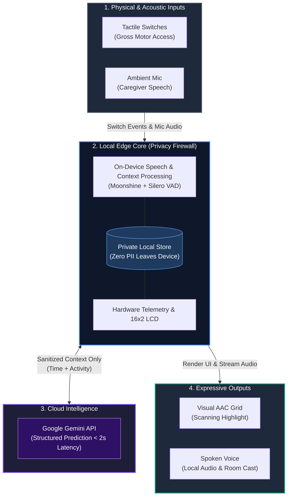

# SaySo: Smart AAC Board
> **HackPrinceton Fall 2026**  
> *A low-cost, open-source, privacy-first physical computing AAC (Augmentative and Alternative Communication) platform empowering nonverbal individuals through tactile hardware, on-device intelligence, and Google Gemini.*

UNO Q Docker deployment: see [the deployment guide](docs/deployment.md) for ARM64
images, persistent storage, local inference, and microphone/button setup.

## Credits

## 📖 Table of Contents
- [The Problem](#-the-problem)
- [Meet SaySo](#-meet-sayso)
- [Core Features](#-core-features)
- [System Architecture](#-system-architecture)
- [How It Works (Demo & User Flow)](#-how-it-works-demo--user-flow)
- [Privacy-First Hybrid AI Design](#-privacy-first-hybrid-ai-design)
- [Repository Structure & Quickstart](#-repository-structure--quickstart)
- [Credits & Licensing](#-credits--licensing)

---

## 🚨 The Problem

Over **5 million individuals** in the United States alone cannot produce speech that meets their daily communication needs due to conditions such as cerebral palsy, ALS, stroke, apraxia, or nonverbal autism.

Today's Augmentative and Alternative Communication (AAC) landscape presents critical barriers:
1. **The Cost Barrier:** Proprietary, dedicated medical speech devices cost between **$5,000 and $15,000**, with insurance approvals frequently denied or delayed for months.
2. **The Touchscreen Trap:** Consumer tablets (such as iPads running Proloquo2Go or TD Snap) rely entirely on capacitive glass screens. For children and adults with tremors, spasticity, or limited fine motor control, glass touchscreens cause frequent mis-taps, accidental double activations, physical fatigue, and intense frustration.
3. **The Speed Barrier:** Traditional static symbol grids require navigating deeply nested category trees. Constructing a single 4-word sentence can take **2 to 3 minutes**, disconnecting the individual from natural conversational flow.
4. **The Privacy Risk:** Cloud-based voice solutions routinely stream raw ambient audio and intimate life logs to remote servers.

---

## 💡 Meet SaySo

**SaySo** bridges the gap between physical accessibility and adaptive AI. It is an affordable, tactile-first AAC device designed to reduce communicative friction:

- **Tactile-First Physical Computing:** Replaces brittle touchscreens with five large, debounced physical buttons and an integrated 16x2 LCD status display, operable via gross motor hand, arm, or switch movements.
- **Conversational Listen Mode:** Listens to ambient caregiver questions (e.g., *"Do you want pancakes or eggs?"*), transcribes the audio strictly on-device, and instantly presents the answer choices on the board.
- **Context-Aware Prediction with Google Gemini:** Automatically anticipates likely phrases based on the time of day and routine activities (e.g., morning breakfast, classroom circle time, bedtime) with sub-2-second latency.
- **Complete Privacy Isolation:** Patient communication histories, audio streams, and profile records remain 100% on the local edge device (SQLite). Only sanitized, zero-PII environmental context is sent to the cloud.
- **10x+ Cost Reduction:** Built on commodity microcomputing hardware, transforming any screen into an enterprise-grade assistive device for under $50.

---

## 🛠️ Core Features

### 1. Tactile Physical Controls (Fine Motor Accessibility)
* **5 Dedicated Hardware Switches:** `PREV`, `NEXT`, `WORD` (Select), `DEL` (Delete), and `SAY` (Speak).
* **High Mechanical Travel:** Long-travel tactile switches provide clear mechanical resistance and audible click confirmation, preventing accidental activations from muscle spasms or tremors.
* **Hardware Debounce & Chords:** 50ms debouncing filter with multi-button chord support (holding `PREV + NEXT` toggles caregiver Listen Mode without ever touching the screen).

### 2. Microcontroller-Driven 16x2 LCD Telemetry
* **Direct 4-Bit Parallel Bus:** Driven directly by low-level microcontroller register routines (HD44780 protocol) without third-party library overhead.
* **Real-Time System Feedback:** Provides glanceable diagnostics—CPU usage, memory allocation, active job queues, and hardware connection state—giving caregivers diagnostic confidence without cluttering the patient's visual field.

### 3. Accessible AAC Frontend
* **Clinical Standard (Fitzgerald Key):** Standardized semantic color-coding (Yellow for pronouns, Green for verbs, Orange for nouns, Pink for social phrases) ensuring instant familiarity for speech therapists and children.
* **Atkinson Hyperlegible Typography:** Designed by the Braille Institute to prevent letter confusion (e.g., I, l, 1) under bright classroom glare.
* **High-Contrast Dual-Switch Scanning:** 6px solid violet scanning highlight with 1.05x magnification and WCAG AAA compliance (7:1+ contrast ratio) visible across a room.
* **Redundant Speech Synthesis:** High-fidelity child neural text-to-speech with an instant offline browser `SpeechSynthesis` fallback—the user is **never** left without a voice if network connectivity drops.

---

## 🏗️ System Architecture

SaySo separates local privacy-sensitive edge computation from cloud prediction via a strict privacy firewall:



---

## 🔄 How It Works (Demo & User Flow)

```text
[1. Listen]       Caregiver asks: "Do you want pancakes or eggs?" 
                         │
[2. On-Device]    Silero VAD + Moonshine transcribe locally -> Extract options
                         │
[3. Predict]      Google Gemini returns 6 structured conversational choices (< 2s)
                         │
[4. Tactile Scan] Child taps physical "NEXT" -> Violet outline jumps to "Pancakes"
                         │
[5. Speak]        Child presses "WORD" -> presses "SAY" -> Room hears: "I want pancakes!"
```

1. **Ambient Turn-Taking:** The caregiver asks a question. Holding `PREV + NEXT` toggles Listen Mode; on-device NLP parses the question and automatically populates the candidate choices.
2. **Context-Aware Suggestions:** Even without speech input, the board automatically updates its prediction row based on the time of day and schedule (breakfast in the morning, bedtime stories at night).
3. **Physical Selection:** The child navigates through the tiles or prediction row using physical buttons, with visual and audible feedback.
4. **Room-Scale Audibility:** Spoken sentences play on device speakers or cast directly to an in-room Google Home smart speaker so everyone can hear.

---

## 🔒 Privacy-First Hybrid AI Design

Assistive medical technology demands uncompromising data privacy. SaySo guarantees that intimate family and medical data are never leaked:

- **What Stays Local (100% On-Device):**
  - Audio recordings and voice transcripts (processed in memory with zero persistence).
  - Patient names, profiles, communication frequency, and past spoken history.
  - Custom vocabulary, favorite foods, and personal preferences stored in local SQLite.
- **What Goes to Cloud (Google Gemini API):**
  - **Only sanitized metadata:** `{ "activity": "breakfast", "time_of_day": "morning" }`.
  - Zero PII, zero transcripts, and zero user identifiers.
- **Google Gemini Optimization:**
  - Uses `gemini-3.5-flash-lite` with `ThinkingLevel.MINIMAL` to guarantee responses within a hard **2-second deadline**.
  - Enforces structured JSON output via `response_json_schema` specifying exactly 6 child-friendly phrases under 100 characters.
  - 
---

## 📂 Repository Structure & Quickstart

```text
├── frontend/             # React + Vite + TypeScript (Accessible AAC UI, Scanning, Caregiver Dashboard)
├── backend/              # Django + Django Channels (ASGI WebSockets, SQLite, Gemini LLM, Speech API)
├── hardware/             # Arduino sketches, bridge script, and 16x2 LCD drivers
│   ├── aac_switch/       # Elegoo UNO R3 firmware for 5 tactile buttons
│   ├── unoq_board/       # Single-board Arduino UNO Q firmware + 16x2 parallel LCD driver
│   ├── bridge.py         # Serial-to-WebSocket input bridge
│   └── unoq_bridge.py    # UNO Q Linux-side bridge & LCD telemetry reporter
└── docs/                 # Architecture, API contracts, and testing guides
```

### Quickstart

#### 1. Backend Setup
```bash
cd backend
python -m venv .venv
# On Windows: .venv\Scripts\activate | On macOS/Linux: source .venv/bin/activate
pip install -r requirements.txt
python manage.py migrate
python manage.py seed_demo
python manage.py runserver 8000
```

#### 2. Frontend Setup
```bash
cd frontend
npm install
npm run dev
# Open http://localhost:5173
```

#### 3. Hardware Bridge Setup
```bash
# Connect the Arduino switch board via USB
python hardware/bridge.py --port <SERIAL_PORT>
```

---

## 📜 Credits & Licensing

- **Mulberry Symbols:** Symbol pictures in `frontend/public/symbols/` are from the [Mulberry Symbols](https://github.com/mulberrysymbols/mulberry-symbols) set, copyright 2018–2026 Steve Lee, licensed under [CC BY-SA 4.0](https://creativecommons.org/licenses/by-sa/4.0/).
- **Atkinson Hyperlegible Font:** Developed by the Braille Institute of America to maximize legibility and visual accessibility.
